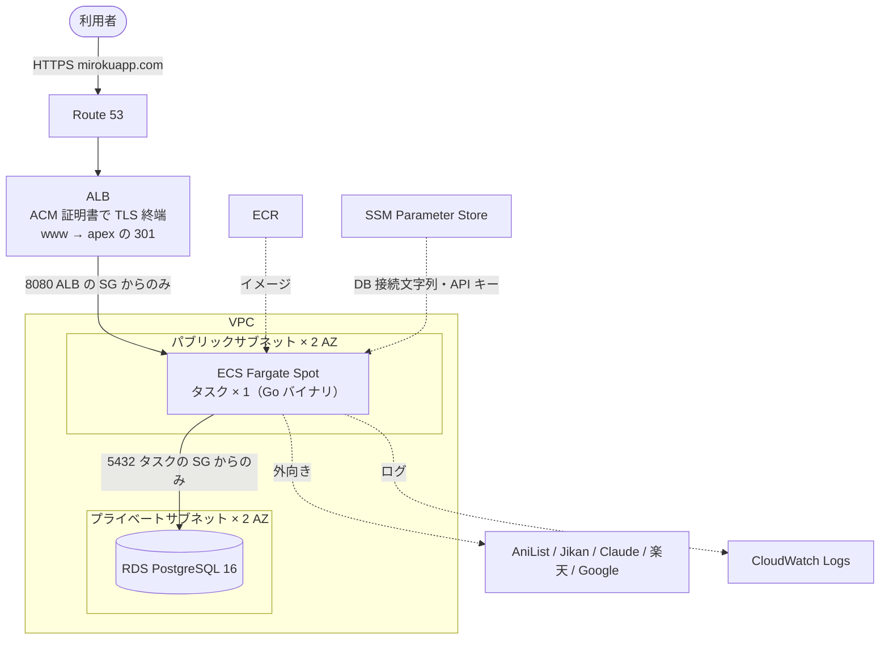
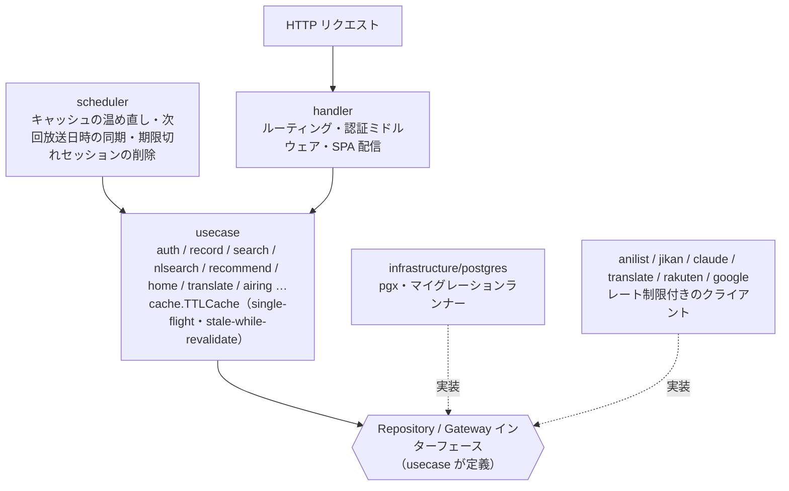

# みろく — アニメ・漫画の記録アプリ

**https://mirokuapp.com**

観ているアニメ・読んでいる漫画の進捗を記録し、今季の放送作品・話題作・新刊を探せる Web アプリです。
Go (Echo) のシングルバイナリが API と React 製フロントエンドを両方配信し、AWS（ECS Fargate + RDS）で動いています。

個人開発のポートフォリオとして、**設計（3 層 + 依存性逆転）**、**自前で書いた認証・セッション管理**、
**外部 API のレート制限を前提にしたキャッシュとジョブの設計**、**本番運用の手順の整備**に力を入れました。
判断の理由は、すべてコードコメントと [`BACKLOG.md`](BACKLOG.md) に残しています。

> 公開サイトは、ログイン画面とプライバシーポリシー以外はログインが必要です。
> メールアドレスとパスワードを登録すれば、すぐに使えます。

---

## 目次

- [主な機能](#主な機能)
- [技術構成](#技術構成)
- [設計](#設計)
- [品質と開発の進め方](#品質と開発の進め方)
- [ローカルで動かす](#ローカルで動かす)
- [環境変数](#環境変数)
- [API](#api)
- [ドキュメント](#ドキュメント)

---

## 主な機能

| 画面 | できること |
| --- | --- |
| ホーム | 今週放送の人気アニメ TOP10、曜日別の放送スケジュール、話題の漫画 TOP10、**AI のおすすめ**（理由付き） |
| シーズン | 2020 年以降の任意の年・シーズンの放送作品を一覧 |
| 検索 | 作品名での検索に加えて、**「内容で探す」**（例: 「主人公が料理で異世界を生き抜く話」）を AI が検索条件に変換 |
| マイライブラリ | 「見たい / 見てる / 見た」の管理、進捗（アニメは話数、漫画は巻数）、5 段階評価、メモ。次回放送が近い順などで並び替え |
| 新着 | 直近 1 週間に発売されたコミック（楽天ブックス）と新連載 |
| おすすめ | ライブラリのジャンル傾向から作品を提案 |
| 作品モーダル | あらすじの日本語訳（AI）、関連作品（続編・前日譚・スピンオフ）、既刊の巻数 |
| 認証 | メール + パスワード、**Google ログイン**（OpenID Connect・PKCE）、パスワード変更 |

Google ログインは実装とローカルでの確認まで済んでおり、本番への反映を進めています。

---

## 技術構成

| 分類 | 使用技術 |
| --- | --- |
| バックエンド | Go 1.25 / [Echo v4](https://echo.labstack.com) / [pgx v5](https://github.com/jackc/pgx) |
| フロントエンド | React 19 / TypeScript / Vite / React Router v7 |
| DB | PostgreSQL 16（マイグレーションはバイナリに埋め込み、起動時に自動適用） |
| 外部 API | AniList (GraphQL) / Jikan (MyAnimeList) / Claude (Anthropic) / MyMemory / 楽天ブックス / Google OAuth |
| インフラ | AWS — ECS Fargate Spot / RDS / ALB / ACM / Route 53 / ECR / SSM Parameter Store / CloudWatch Logs |
| CI | GitHub Actions（gofmt・go vet・go build / oxlint・tsc・vite build） |

### AWS の構成



- **NAT ゲートウェイは作っていません**（月 $33 前後かかるため）。タスクはパブリックサブネットに置き、
  パブリック IP で外に出ます。インターネットからの入口は、セキュリティグループで ALB だけに絞っています。
- **タスクは常に 1 つ**です（理由は[次の節](#プロセス内で完結させ水平スケールしない)）。デプロイも
  `minimumHealthyPercent: 0` / `maximumPercent: 100` にして、2 タスクが並走しないようにしています。
- 構成図（AWS 公式アイコン）は [`docs/diagrams/aws-architecture.drawio`](docs/diagrams/aws-architecture.drawio) にあります。

---

## 設計

### 3 層 + 依存性逆転

`handler` → `usecase` → `repository` / `gateway` の 3 層で、依存は常に内側を向きます。
**usecase 層が自分でインターフェースを定義し**、PostgreSQL の実装と外部 API のクライアントがそれを実装します。
usecase は具体的な DB や API を知らないので、テストは手書きの fake に差し替えて外部に触れずに回せます。



入口は HTTP リクエストと定期ジョブの 2 つで、どちらも同じ usecase を通ります。

| ディレクトリ | 役割 |
| --- | --- |
| `cmd/server/` | エントリポイント。DI の配線、マイグレーション、HTTP サーバーとスケジューラの起動・停止 |
| `internal/domain/` | ドメインモデルと値オブジェクト。他の層に依存しない |
| `internal/usecase/` | ユースケース層。インターフェースもここで定義する |
| `internal/handler/` / `internal/middleware/` | HTTP ハンドラ、ルーティング、認証・レート制限のミドルウェア |
| `internal/scheduler/` | プロセス内の定期ジョブランナー |
| `internal/infrastructure/postgres/` | リポジトリの実装、接続プール、マイグレーションランナー |
| `internal/anilist/` ほか | 外部 API のクライアント（`jikan` / `claude` / `translate` / `rakuten` / `google`） |
| `migrations/` | `NNNN_name.up.sql` / `.down.sql` の組（`embed.FS` でバイナリに埋め込む） |
| `frontend/` | React + Vite |

### 外部 API のレート制限を前提にする

作品情報の大半を AniList（目安 30 リクエスト/分）に頼っているため、多くの判断がこの上限から決まっています。

- **AniList はトークンバケット**（バースト 5、2.5 秒に 1 個回復）。固定間隔ではなく「直近 1 分の本数」で
  数えられる制限なので、画面の初期表示で数本重なっても待たせずに通せます。
  429 を受けたら、リトライする呼び出しだけでなく**共有バケットの再開時刻ごと後ろ倒し**にして、
  同時に走る他の呼び出しもまとめて待たせます。
- **キャッシュは stale-while-revalidate**。TTL が切れても上限（TTL の 10 倍）までは古い値を即座に返し、
  裏で 1 本だけ取り直します。取り直しに失敗しても古い値は捨てないので、上流が一時的に落ちていても画面は出ます。
- **同じキーへの同時アクセスは single-flight** で 1 本にまとめます。
- **起動直後にキャッシュを温め**、以後も定期ジョブで先回りして更新します。Fargate Spot の中断や
  再デプロイでメモリが空になっても、最初の利用者を待たせないためです。
- **補完的な情報の失敗は本体を止めません。** Jikan での補完が失敗してもランキングは返し、
  検索のフォールバックが失敗しても AniList の結果は返します。

### プロセス内で完結させ、水平スケールしない

キャッシュ・single-flight・トークンバケット・定期ジョブは、すべて 1 プロセスのメモリ上にあります。
Redis などの外部ミドルウェアを持たずに済む代わりに、**水平スケールは意図的に封印**しています
（2 タスクになると外部 API の実効レートが倍になり、429 を踏むため）。
この前提はデプロイ設定（タスク数 1、ローリングデプロイでも並走させない）まで一貫させています。

### 認証は自前で書く

外部の IdP（Auth0 / Firebase など）に任せず、セッション管理を自分で実装しています。
見せたいのがまさにこの部分だからです（判断の経緯は `BACKLOG.md` の 8）。

- パスワードは bcrypt。セッショントークンは `crypto/rand` の 32 バイトで、**DB には SHA-256 のハッシュだけ**を保存します
  （DB が漏れてもセッションを乗っ取れない）
- Cookie は `HttpOnly` / `Secure` / `SameSite=Lax`、有効期限は 30 日
- ログインの手段を `user_identities` テーブルに分け、パスワードと Google を同じユーザーに紐付けられるようにしています
- Google ログインは認可コードフロー + PKCE。state は短命の Cookie で照合します
- ログイン失敗は、メール未登録でもパスワード違いでも同じエラーを返します（ユーザー列挙を防ぐ）
- レート制限は二段構え（未認証の API 全体を IP 単位で、ログインはさらに厳しく）。入力サイズにも上限を設けています
- **他人のデータへの到達は SQL で防ぎます**。リポジトリの全クエリに `AND user_id = $N` を付け、
  他人の記録は「存在しない」と区別できない `ErrNotFound` にします

### AI はデータ源にしない

Claude（Haiku）は、あらすじの翻訳・自然文検索・AI おすすめに使っています。
ただし、**作品・話数・放送日・画像などの事実は必ず外部 API から取り、AI はそれを加工するだけ**にしています。
LLM は学習時点までしか知らず、話数や放送日をもっともらしく捏造しうるからです。

- 自然文検索は、文を AniList の**検索条件**（ジャンル・タグ・キーワード）に変換させ、作品は AniList から引きます
- AI おすすめは、利用者の記録から好みを検索条件にし、AniList の候補を AI が並べ替えて理由を添えます。
  作品名を AI に直接挙げさせないので、存在しない作品や古い作品が出ません
- AI の経路のどこで失敗しても、従来の検索・ジャンルベースのおすすめ・機械翻訳（MyMemory）に落ちます
- 費用はプロセス全体の**日次トークン上限**で抑え、翻訳結果は DB に保存して同じ原文では呼びません

### データモデル

中心は `records` で、1 行が「ある利用者の、ある作品 1 つ分の記録」です。
作品情報は AniList が正なので、作品のマスタテーブルは持たず、表示に要るぶん（タイトル・表紙・ジャンル）だけを行に持ちます。
進捗（`progress` / `total`）の単位は種別で決まり、アニメは話数、漫画は巻数です。

| テーブル | 役割 |
| --- | --- |
| `users` | 利用者 |
| `user_identities` | ログインの手段（`password` / `google`） |
| `sessions` | セッショントークンのハッシュと有効期限 |
| `records` | ライブラリの 1 作品。`(user_id, anilist_id, media_type)` が UNIQUE |
| `translations` | AI 翻訳の保存先 |

---

## 品質と開発の進め方

- **テスト** — Go のテストは 33 ファイル・200 以上のテスト関数です。モックライブラリは使わず、usecase が定義した
  インターフェースを満たす fake を手書きし、呼び出し回数や引数を記録して検証します。
  ユーザーとログイン手段まわりの SQL は、実際の PostgreSQL に対する結合テストも置いています
- **マイグレーション** — 自作のランナーで、ファイルごとにトランザクションで包み、`pg_advisory_lock` を掛けてから流します。
  本番で `down` が必要になったときの手順と SQL も、ローカルの使い捨て DB で通し稽古してから手順書にしています
- **本番の手順書** — [`docs/DEPLOY-AWS.md`](docs/DEPLOY-AWS.md) は、上から順に実行すれば構築とデプロイができる粒度で書いています。
  費用・つまずきポイント・マイグレーションを含むデプロイの戻し方まで含みます
- **AI エージェントと開発する際のガードレール** — Claude Code と開発しており、[`CLAUDE.md`](CLAUDE.md) に
  不変条件を書いたうえで、フックで「main ブランチでの編集」「AWS を変更するコマンド」「認証情報ファイルの読み取り」を
  機械的に止めています（フックには回帰テストがあります）。本番を変える操作は、手順書を見ながら人間が実行します

---

## ローカルで動かす

### Docker Compose でまとめて動かす

```sh
docker compose up --build
```

http://localhost:8090 で起動します。未適用のマイグレーションは起動時に自動で適用されます。

### 開発用（ホットリロードあり）

DB だけ Compose で起動し、バックエンドとフロントエンドは手元で動かします。

```sh
docker compose up -d postgres      # 1. DB
cp .env.example .env               # 2. 環境変数
go run ./cmd/server                # 3. API サーバー（:8090）
cd frontend && npm install && npm run dev   # 4. フロントエンド（:5174。/api は API サーバーへ中継）
```

ブラウザで http://localhost:5174 を開きます。Vite の中継先のポートは、リポジトリ直下の `.env` の
`BACKEND_PORT` → `PORT` → `8080` の順に決まります。

外部 API のキーは無くても動きます（AI 機能・新刊・Google ログインが無効になるだけです）。
なお、サーバーは起動直後に AniList / Jikan を十数本叩いてキャッシュを温めます。

### 開発コマンド

```sh
go test ./...          # バックエンドのテスト（CI では回していないので手元で必ず実行する）
gofmt -l .             # フォーマットチェック（CI と同じ）
go vet ./...
go build ./...

cd frontend
npm run lint           # oxlint
npm run build          # tsc -b && vite build
```

---

## 環境変数

ローカルではリポジトリ直下の `.env` を読みます（無くてもエラーにはなりません）。本番は ECS のタスク定義と
SSM Parameter Store から渡します。

| 変数 | 必須 | 既定値 | 説明 |
| --- | --- | --- | --- |
| `DATABASE_URL` | ✓ | — | PostgreSQL の接続文字列 |
| `PORT` | | `8080` | 待ち受けポート |
| `COOKIE_SECURE` | | `false` | セッション Cookie に `Secure` を付けるか。HTTPS の環境では `true`（平文 HTTP で `true` にするとログインできない） |
| `TRUST_PROXY` | | `false` | `X-Forwarded-For` を信じるか。ALB の後ろでは `true`（`false` のままだと全員が 1 つのレート制限を共有する） |
| `ANTHROPIC_API_KEY` | | — | Claude の API キー。未設定なら AI 機能は無効になり、翻訳は MyMemory だけで動く |
| `CLAUDE_DAILY_TOKEN_LIMIT` | | `2000000` | Claude に 1 日（JST）で使ってよいトークン数 |
| `RAKUTEN_APPLICATION_ID` / `RAKUTEN_ACCESS_KEY` | | — | 楽天ブックス書籍検索 API（新刊）。両方揃わなければ新刊は「未設定」になる |
| `RAKUTEN_REFERER` | | `https://mirokuapp.com/` | 楽天に登録したサイト（Referer / Origin として送る） |
| `RAKUTEN_AFFILIATE_ID` | | — | 商品リンクを楽天アフィリエイト経由にする |
| `GOOGLE_CLIENT_ID` / `GOOGLE_CLIENT_SECRET` / `GOOGLE_REDIRECT_URL` | | — | Google ログイン。3 つとも揃わなければ無効になり、ボタンも出ない |

真偽値として解釈できない値は、黙って既定値にせず起動時にエラーにします。

---

## API

`/api/auth/*` と `/healthz` 以外は、すべてログイン（セッション Cookie）が必要です。未ログインなら 401 を返します。

| メソッド | パス | 説明 |
| --- | --- | --- |
| `POST` | `/api/auth/signup` | 新規登録 |
| `POST` | `/api/auth/login` | ログイン |
| `POST` | `/api/auth/logout` | ログアウト |
| `POST` | `/api/auth/password` | パスワード変更 |
| `GET` | `/api/auth/me` | ログイン中のユーザーとログインの手段 |
| `GET` | `/api/auth/providers` | 使えるログインの手段（`{"google": true}` など） |
| `GET` | `/api/auth/google/start` / `/callback` | Google ログインの開始と戻り先 |
| `GET` | `/api/records?type=&status=&sort=` | ライブラリ一覧（`sort`: `default` / `title` / `score` / `updated` / `added`） |
| `POST` | `/api/records` | ライブラリに追加 / ステータス変更 |
| `PATCH` | `/api/records/:id` | 進捗・評価・メモ・ステータスの更新 |
| `DELETE` | `/api/records/:id` | ライブラリから削除 |
| `GET` | `/api/search?type=&q=` | 作品名で検索 |
| `GET` | `/api/search/natural?type=&q=` | 内容で検索（AI が検索条件に変換） |
| `GET` | `/api/anilist/media?type=&ids=` | ID 指定で作品情報をまとめて取得 |
| `GET` | `/api/anilist/relations?id=` | 関連作品 |
| `GET` | `/api/recommendations?type=&genres=` | ジャンル指定のおすすめ |
| `GET` | `/api/recommendations/ai?type=` | AI のおすすめ（失敗時はジャンルベースに落ちる） |
| `GET` | `/api/home/season-anime[?season=&year=]` | 今季（または指定シーズン）のアニメ |
| `GET` | `/api/home/trending` | 人気アニメ |
| `GET` | `/api/home/trending-manga` | 話題の漫画（Jikan でランキング・掲載誌を補完） |
| `GET` | `/api/home/new-series` | 新連載 |
| `GET` | `/api/new-releases/comics` | 直近 1 週間に発売されたコミック |
| `GET` | `/api/books/latest-volume` | 漫画の既刊の巻数 |
| `POST` | `/api/translate` | あらすじの翻訳 |
| `GET` | `/healthz` | ヘルスチェック（DB の疎通だけを見る。外部 API は叩かない） |

`/api/*` と `/healthz` 以外のパスは `frontend/dist` の静的ファイルにフォールバックします（SPA ルーティング）。

---

## ドキュメント

| ファイル | 内容 |
| --- | --- |
| [`docs/ARCHITECTURE.md`](docs/ARCHITECTURE.md) | 実装と処理フローの全体像（キャッシュ・定期ジョブ・認証の詳細） |
| [`BACKLOG.md`](BACKLOG.md) | 残タスクと、設計判断の記録（何を選び、何を選ばなかったか） |
| [`docs/DEPLOY-AWS.md`](docs/DEPLOY-AWS.md) / [`docs/DEPLOY-AWS-PHASE2.md`](docs/DEPLOY-AWS-PHASE2.md) | AWS の構築・デプロイ・運用の手順書 |
| [`docs/PARALLEL-AGENTS.md`](docs/PARALLEL-AGENTS.md) | 複数の AI エージェントで並列に開発するときの手順と制約 |
| [`CLAUDE.md`](CLAUDE.md) | AI エージェント向けの、壊してはいけない不変条件と規約 |
